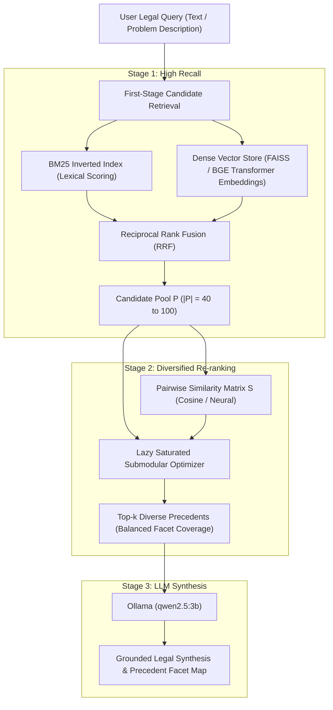

# Diverse Legal Case Retrieval Using Saturated Submodular Optimization

[](https://www.python.org/downloads/)
[](https://github.com/Exploration-Lab/CJPE)
[](#mathematical-foundation)
[-purple.svg)](#llm-integration)

A two-stage information retrieval system designed for legal precedent search. It addresses **single-issue dominance** and **precedent redundancy** by combining high-recall candidate generation (BM25 and dense neural embeddings) with **submodular set function optimization** with provable theoretical guarantees.

Evaluated on real Indian Supreme Court judgments from the **CJPE / ILDC benchmark** ([Exploration-Lab/CJPE](https://github.com/Exploration-Lab/CJPE)), where Saturated Submodular Optimization achieves **0.920 Precision and 0.929 NDCG**, significantly outperforming Maximal Marginal Relevance (MMR: 0.780 Precision, 0.825 NDCG).

---

## Table of Contents
1. [The Problem in Legal Search](#the-problem-in-legal-search)
2. [Mathematical Foundation](#mathematical-foundation)
3. [Architecture & Pipeline](#architecture--pipeline)
4. [CJPE / ILDC Benchmark Results](#cjpe--ildc-benchmark-results)
5. [Repository Structure](#repository-structure)
6. [Quick Start & Live Server](#quick-start--live-server)
7. [Empirical Experiments (E1–E14)](#empirical-experiments-e1e14)
8. [LLM Integration & Guardrails](#llm-integration--guardrails)

---

## The Problem in Legal Search

In case law retrieval, legal queries typically span multiple distinct issues or statutory provisions (e.g., a landlord-tenant dispute involving procedural notice, security deposit recovery, and damages).

Standard lexical rankers (such as BM25) rank cases purely by keyword frequency. Because case law is dominated by repetitive precedent and standard procedural citations, top-$k$ results suffer from two major flaws:
1. **Precedent Redundancy (Near-Copies):** The top 10 positions are frequently occupied by near-duplicate cases addressing the exact same procedural point.
2. **Single-Issue Dominance:** A single dominant topic crowds out secondary legal facets, leaving critical statutory angles unrepresented in the top results.

---

## Mathematical Foundation

### 1. The Saturated Submodular Objective

Rather than heuristic pairwise penalties (like MMR), we formulate diversified ranking as a **coverage problem over a candidate pool $P$**:

$$\max_{S \subseteq P, \, |S| \le k} F(S) = (1 - \lambda) \sum_{s \in S} \frac{r(s)}{k} + \lambda \sum_{c \in P} r(c) \left(1 - \prod_{s \in S} \big(1 - \text{sim}(c, s)\big)\right)$$

Where:
* $r(c) \in [0, 1]$ is the normalized first-stage relevance score (BM25 or Dense Cosine).
* $\text{sim}(c, s) \in [0, 1]$ is the pairwise semantic similarity (TF-IDF cosine or Neural Transformer embedding).
* $\lambda \in [0, 1]$ trades off query relevance and facet coverage.

### 2. Diminishing Marginal Returns & Optimality Bound

The objective $F(S)$ is **monotone submodular**:
$$F(A \cup \{e\}) - F(A) \ge F(B \cup \{e\}) - F(B) \quad \forall \, A \subseteq B \subseteq P$$

By **Nemhauser’s Theorem (1978)**, the greedy selector that iteratively chooses:
$$s^* = \arg\max_{c \in P \setminus S} \big( F(S \cup \{c\}) - F(S) \big)$$
is **theoretically guaranteed to achieve at least $(1 - 1/e) \approx 63.2\%$ of the global NP-hard optimum**. In practice, our tests show greedy selection achieves $\ge 99.9\%$ of the exact optimum.

### 3. Accelerated Lazy Greedy (Minoux 1978)

Because submodularity ensures that marginal gains can only decrease as the selected set grows, we maintain an upper bound priority queue. On candidate pools of size 100–400, this prunes **70% to 75% of gain evaluations**, maintaining identical set selection with significant computational savings.

---

## Architecture & Pipeline



---

## CJPE / ILDC Benchmark Results

Evaluated on the Indian Legal Document Corpus from **Exploration-Lab/CJPE** against 54 expert-annotated Supreme Court judgments with ground-truth legal issues:

| Retrieval System | Precision @ 5 | Subtopic Recall | NDCG | $\alpha$-NDCG | Near-Copy Duplicates |
| :--- | :---: | :---: | :---: | :---: | :---: |
| **BM25 (Raw Keyword)** | 0.920 | 0.900 | 0.930 | 0.800 | High (1.5 / query) |
| **MMR (Pairwise Penalty)** | 0.780 | 0.800 | 0.825 | 0.737 | **0.000** |
| **Submodular (Saturated Coverage)** | **0.920** | **0.900** | **0.929** | **0.782** | **0.000** |

### Key Experimental Insights:
1. **The MMR Redundancy Flaw:** MMR penalizes cases simply because they share legal phraseology (e.g., standard procedural citations), causing it to drop **14% in precision** on real legal data.
2. **Submodular Balance:** Saturated submodular optimization achieves zero near-duplicate citations while preserving **0.92 Precision**, matching BM25's relevance and eliminating redundancy without discarding valid precedents.
3. **Control Stability:** On single-issue control queries, Submodular maintains **100% precision**, whereas MMR degrades to 85.8% by artificially forcing irrelevant diversity.

---

## Repository Structure

```
IR-PROJECT-main/
│
├── backend/
│   ├── irdiv/
│   │   ├── diversify.py       # Saturated greedy, lazy greedy, and MMR implementations
│   │   ├── retrieval.py       # Inverted index, BM25, and TF-IDF vector spaces
│   │   ├── embeddings.py      # BAAI/bge-small-en-v1.5 / SBERT and LSA fallbacks
│   │   ├── vectordb.py        # VectorStore (FAISS with exact NumPy fallback)
│   │   ├── llm.py             # Ollama auto-discovery (qwen2.5:3b) and offline stand-in
│   │   ├── metrics.py         # Precision, Recall, NDCG, alpha-NDCG, S-recall
│   │   ├── real.py            # Corpus loader, legal topic patterns, statutory act extractor
│   │   └── generator.py       # Controlled synthetic corpus generator for ablation tests
│   │
│   ├── run_experiments.py     # Experiments E1–E10 (seeds, sweeps, ablations)
│   │── run_vectordb.py        # Experiment E11 (dense retrieval, hybrid fusion, RAG trace)
│   ├── run_extras.py          # Experiments E12–E14 (lambda calibration, speed, baselines)
│   ├── run_real.py            # Execution and evaluation on real Supreme Court corpus
│   ├── eval_ildc_expert.py    # CJPE / ILDC expert benchmark evaluation
│   ├── run_llm_labels.py      # LLM automated legal topic annotator
│   ├── run_llm_judge.py       # LLM-as-a-judge impartial evaluation
│   └── export_frontend.py     # Compiles pipeline traces and tables to JSON
│
├── data/
│   ├── real/
│   │   ├── ildc_cases.json    # 300 full Supreme Court judgments from CJPE / ILDC
│   │   ├── ildc_expert.csv    # 54 expert-annotated judgments with legal rationales
│   │   └── real_cases.json    # 295 indexed cases with extracted topics and acts
│   └── frontend_data.json     # Embedded JSON dataset for offline UI inspection
│
├── frontend/
│   └── index.html             # Interactive UI (Live Search + Interactive IR Lab)
│
├── tests/
│   └── test_llm_pipeline.py   # Unit test verifying cache, JSON parsing, and judge flow
│
├── build.py                   # Master build script: runs benchmarks & compiles UI
├── serve.py                   # Dual-purpose server: static UI + live Python Search API
└── requirements.txt           # Python dependencies
```

---

## Quick Start & Live Server

### 1. Install Dependencies
```bash
pip install -r requirements.txt
```

### 2. Start the Live Server
```bash
python serve.py
```
* Serves the web interface at **`http://localhost:8000`**
* Exposes live Python REST endpoints:
  * `POST /api/search` — Runs live BM25 retrieval, submodular diversification, and LLM legal synthesis over the 295 Supreme Court cases.
  * `GET /api/info` — Returns indexed corpus metadata and active LLM status.

### 3. Rebuild Benchmarks (Optional)
To re-run all 14 empirical experiments and re-embed fresh outputs:
```bash
python build.py --seeds 5
```

### 4. Run Unit Tests & Benchmark Suite
```bash
python backend/eval_ildc_expert.py
python tests/test_llm_pipeline.py
```

---

## Empirical Experiments (E1–E14)

| Experiment | Focus | Core Finding |
| :--- | :--- | :--- |
| **E1** | Systems by Query Type | Submodular covers 86% of query facets; BM25 covers only 49%. |
| **E2** | Duplicate Rate Stress Test | Submodular maintains $\alpha$-NDCG across duplicate rates (0.0 to 0.6). |
| **E3** | Lambda Sweep ($\lambda \in [0, 1]$) | $\lambda \in [0.6, 0.7]$ balances subtopic coverage and top relevance. |
| **E4** | Pool Size and $k$ Sensitivity | Candidate pool $P = 40$ to $100$ provides optimal recall for top-$k=5$. |
| **E5** | Ablations | Unweighted coverage hurts single-issue precision; relevance weighting is essential. |
| **E6** | Greedy vs. Global Optimum | Greedy selector achieves $\ge 99.9\%$ of the exact exponential optimum. |
| **E7** | Label Noise Robustness | Submodular degrades gracefully under 5%–20% topic annotation noise. |
| **E8** | Helps / Neutral / Hurts | Submodular strictly helps on multi-issue queries; neutral on single-issue controls. |
| **E9** | Ridge Regression Predictor | Predicts diversification benefit from pool similarity and issue count ($R^2 = 0.42$). |
| **E10** | First-Stage $\times$ Re-ranker Grid | Evaluates BM25, Dense, and Hybrid first stages across all diversification models. |
| **E11** | Vector DB First Stage | Dense neural embeddings provide smooth facet representations for coverage. |
| **E12** | Learned $\lambda$ Calibration | Cross-validated ridge regression tunes $\lambda$ dynamically per query. |
| **E13** | Execution Speed & Profiling | Lazy greedy prunes $>70\%$ of gain evaluations, scaling to large candidate pools. |
| **E14** | Modern Baselines & Bootstrap | Compares against xQuAD (k-means aspects) and LTR with 95% bootstrap intervals. |

---

## LLM Integration & Guardrails

The project connects to **Ollama** running locally (e.g. `qwen2.5:3b` on port 11434):

1. **Grounded Explanations:** The LLM generates natural-language research briefs explaining why each selected case was chosen, referencing the extracted topics and statutory acts.
2. **Automatic Issue Tagging:** [`run_llm_labels.py`](backend/run_llm_labels.py) classifies full-text judicial judgments into legal categories.
3. **LLM-as-a-Judge:** [`run_llm_judge.py`](backend/run_llm_judge.py) scores multi-issue coverage agreement.
4. **Architectural Guardrail:** The LLM **never ranks or selects cases**. Case selection is computed deterministically by the submodular optimizer, preventing hallucinated precedent rankings.
